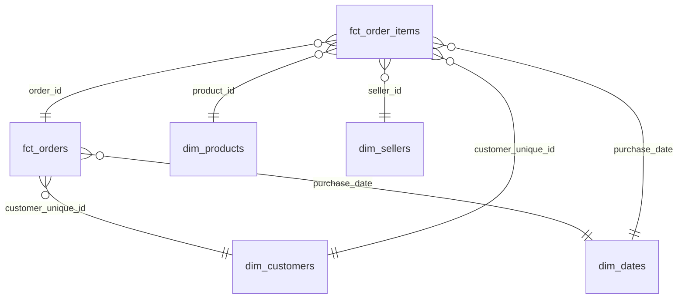

# Data Model: Star Schema Design

- **Status:** Accepted
- **Date:** 2026-11-10

## Goals

The marts layer must answer the questions an e-commerce leadership team asks:

1. **Sales:** How much are we selling, of what, where, and how is it trending?
2. **Delivery:** Are we delivering on time? Where and why not?
3. **Customer experience:** How satisfied are customers, and what drives bad reviews?
4. **Customers:** How many people buy, and how many come back?
5. **Sellers:** Which sellers drive volume and which drive problems?

## Design

A **star schema**: two fact tables (events and measurements) surrounded by
dimension tables (the who, what, where and when used to filter and group).

### Fact tables

| Table | Grain (one row per…) | Key measures | Answers |
|---|---|---|---|
| **fct_orders** | order | item count, seller count, items value, freight, order value, payment total, review score, days to deliver, days late, is_late | Sales trend, delivery performance, satisfaction, order-level KPIs |
| **fct_order_items** | item within an order | item price, freight | Sales by product category, by seller, by seller state |

**Why two facts?** Some questions are about orders (was it late? what was the
review?) and some are about items (which category sold?). An order can contain
items from several sellers and categories (1,278 orders have more than one
seller), so seller and product can't live on the order fact without picking one
arbitrarily. Keeping each fact at its natural grain avoids double counting.

### Dimension tables

| Table | Grain | Key attributes | Notes |
|---|---|---|---|
| **dim_customers** | person (`customer_unique_id`) | city, state, lat/lng, first and last order date, lifetime orders, is_repeat_customer | DQ-5: keyed on the person, not the per-order ID. 250 people have orders from more than one zip; we use their **most recent** location. |
| **dim_sellers** | seller | city, state, lat/lng | |
| **dim_products** | product | category (English → Portuguese → `unknown`), size, weight, photo count | DQ-3 fallback applied here. |
| **dim_dates** | calendar day, 2016-01-01 to 2018-12-31 | year, quarter, month, week, day of week, is_weekend | Lets dashboards show days with zero orders. |

### Intermediate models (building blocks, not queried by dashboards)

| Model | Purpose | Handles |
|---|---|---|
| `int_geolocation__by_zip` | One row per zip prefix, average lat/lng | DQ-2 (row explosion) |
| `int_orders__items_agg` | Item count, seller count, items value and freight per order | Rolls item grain up to order grain |
| `int_orders__payments_agg` | Payment total, main payment type, installments per order | Rolls payment grain up to order grain |
| `int_orders__latest_review` | One review per order: the most recently answered | 547 orders have more than one review |

## Edge cases found while designing

| Fact | Count | Handling |
|---|---:|---|
| Orders with no items | 775 | Kept in `fct_orders` with zero values and `has_items = false` (mostly canceled/unavailable). |
| Orders with no review | 768 | Review fields null; `has_review = false`. |
| Orders with no payment record | 1 | Payment fields null. |
| Orders where payments ≠ items + freight (> 1 BRL) | 249 | Revenue is measured from items, not payments (see below). Gap kept visible as a reconciliation column. |
| People with more than one order | 2,997 | Only ~3% of buyers repeat. This is a headline insight, not a bug. |

## Metric definitions

Agreed 2026-11-10. These are the single source of truth: every dashboard and
model must use these definitions.

**Decisions:**
- **Revenue excludes freight.** Freight is a pass-through shipping cost; product
  price only is the standard marketplace GMV and splits cleanly by category and seller.
- **Orders and Revenue count every order except `canceled` and `unavailable`.**
  In-progress orders (created → shipped) are real sales; "delivered only" would
  understate recent months.

| Metric | Definition |
|---|---|
| **Orders** | Count of orders, excluding `canceled` and `unavailable` |
| **Revenue (GMV)** | Sum of `item_price` on those orders. Excludes freight. Measured from items, not payments, so it can be split by product and seller and always reconciles between the two fact tables. |
| **Average order value (AOV)** | Revenue ÷ Orders |
| **On-time rate** | Delivered orders where `delivered_to_customer_at` ≤ `estimated_delivery_date`, ÷ all delivered orders |
| **Average review score** | Mean of the latest review score per order, for orders with a review |
| **Repeat customer rate** | People with 2+ orders ÷ all people with an order |

## Out of scope (for now)

- **Payments fact table:** payment details are summarized on `fct_orders`, which
  covers payment-mix questions. A separate fact can be added later if needed.
- **Slowly changing dimensions:** customer and seller locations are treated as
  fixed (most recent value). History tracking adds complexity without a clear
  question that needs it.
